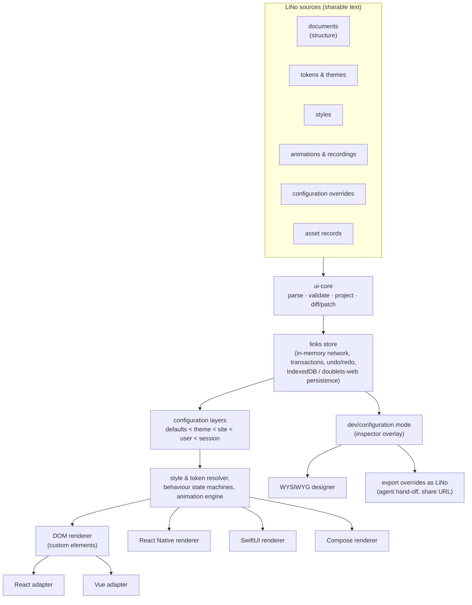

# Architecture (proposal)

This document is the target architecture of the associative UI framework
planned in [issue #1](https://github.com/link-foundation/ui/issues/1). It is a
**proposal**: every part of it is delivered by a roadmap issue listed in
[`ROADMAP.md`](ROADMAP.md), and each roadmap issue may refine it. The evidence
behind each decision is in the
[issue 1 case study](case-studies/issue-1/README.md).

## Principles

1. **Links first.** Every UI concept (element, property, style rule, design
   token, theme, behaviour, data binding, animation, recording, configuration
   override, asset licence) is a link in a links network. Links Notation
   (LiNo, [link-foundation/links-notation](https://github.com/link-foundation/links-notation))
   is its only canonical text form. JSON, CSS, JSX, XAML, SwiftUI and so on are
   import or export formats, never the source of truth.
2. **One dialect.** Structure, configuration, styles, tokens, animations and
   recordings use one LiNo vocabulary (the _UI dialect_), so any other UI
   framework can be described as a LiNo document in that dialect.
3. **Sharable by default.** A UI, a theme, a set of overrides or a recording is
   a plain LiNo text that can be pasted into an issue, a chat with an agent,
   or a URL.
4. **Runtime interpreter, thin renderers.** One platform-neutral core
   interprets the links network. Each platform (DOM, React, Vue, React Native,
   SwiftUI, Jetpack Compose) has a thin renderer. Code generation is used only
   for wrappers, types and optional "eject to code" exports.
5. **JavaScript first.** As required by [`javascript-first.md`](javascript-first.md),
   the JavaScript implementation and shared conformance fixtures come first.
   Swift and Kotlin ports must pass the same fixtures.
6. **Everything editable at runtime.** Every rendered element keeps a stable
   link ID that maps back to its LiNo source. This is what makes the
   development/configuration mode and the WYSIWYG designer possible on any
   site built with the framework.
7. **Public domain.** Code is released under the [Unlicense](../LICENSE). Our
   own non-code assets are dedicated to the public domain (CC0-1.0).
   Third-party assets are allowed only with a machine-readable record of the
   source, copyright holder, licence (SPDX ID) and attribution text.

## Layers



| Layer                 | Package (working name)                         | Responsibility                                                                                                                                  |
| --------------------- | ---------------------------------------------- | ----------------------------------------------------------------------------------------------------------------------------------------------- |
| Dialect specification | `docs/spec/`                                   | Vocabulary, grammar of the UI dialect on top of LiNo, conformance fixtures shared by every implementation.                                      |
| Core                  | `@link-foundation/ui-core`                     | Parse LiNo (via `links-notation`), project links into an element tree, validate against the dialect, format back, diff and patch.               |
| Store                 | `@link-foundation/ui-store`                    | Mutable links network with stable IDs, change events, transactions, undo/redo, persistence (IndexedDB; `doublets-web` compatible).              |
| Links                 | `@link-foundation/ui-links`                    | Associative doublets storages behind one interface, link-cli substitution queries, types and permissions as links, links server, synced client. |
| Configuration         | `@link-foundation/ui-config`                   | Layered configuration and overrides; export of overrides as LiNo patches.                                                                       |
| Settings              | `@link-foundation/ui-settings`                 | Settings schemas in LiNo: validation, presets, migrations, diff-only values documents and share links, before-paint application.                |
| Tokens and themes     | `@link-foundation/ui-tokens`                   | Design tokens in LiNo; export to CSS custom properties, DTCG 2025.10 JSON, Swift and Kotlin.                                                    |
| Styles                | `@link-foundation/ui-style`                    | Style rules as links (selectors, states, responsive conditions) resolved against tokens.                                                        |
| DOM renderer          | `@link-foundation/ui-dom`                      | Reference renderer with custom elements and incremental updates.                                                                                |
| Framework adapters    | `ui-react`, `ui-vue`, `ui-react-native`        | Thin bindings over the core and DOM renderer (React Native renders natively).                                                                   |
| Native ports          | `ui-swift` (SwiftPM), `ui-kotlin` (Gradle/KMP) | SwiftUI and Jetpack Compose renderers of the same dialect.                                                                                      |
| Components            | `@link-foundation/ui-components`               | Controls, layout, chat, charts, diagrams, links-network visualisation; behaviour as state machines described in LiNo.                           |
| Animation             | `@link-foundation/ui-animation`                | Keyframe/spring/timeline model, player (Web Animations API), recorder (timestamped LiNo events).                                                |
| Dev mode              | `@link-foundation/ui-devmode`                  | Runtime inspector overlay, property editing, persistence, "make these the defaults" export.                                                     |
| Designer              | `@link-foundation/ui-designer`                 | Visual Studio-like WYSIWYG designer built with the framework itself.                                                                            |
| Converters            | `@link-foundation/ui-convert`                  | Importers (HTML/DOM, JSX/MUI, Vue SFC, Mermaid, Vega-Lite, Lottie, DTCG) and exporters.                                                         |
| Assets                | `assets/` + `assets.lino`                      | Own CC0 assets and third-party asset records with SPDX licences.                                                                                |

Package names are working names; the monorepo issue decides the final ones.

## The UI dialect (sketch)

The samples below are in
[`case-studies/issue-1/samples/`](case-studies/issue-1/samples/) and are
checked by [`experiments/issue-1/lino-ui-dialect-roundtrip.mjs`](../experiments/issue-1/lino-ui-dialect-roundtrip.mjs):
`links-notation` 0.27.1 parses every sample and formats it back to an equal
links network.

A document (structure, configuration and behaviour in one place):

```lino
app: document
  title 'Links UI demo'
  theme material3
  body: stack
    direction vertical
    gap
      token space.medium
    greeting: text 'Hello, links'
    ok: button
      label 'OK'
      variant filled
      on press
        navigate home
```

Tokens and themes:

```lino
material3: theme
  extends base
  token color.primary '#6750A4'
  token space.medium 16px
  token motion.duration.short 150ms
```

Animation and a recording:

```lino
press-feedback: animation
  target ok
  duration
    token motion.duration.short
  track scale
    key 0 1
    key 0.5 0.96
    key 1 1
recording-1: recording
  event 0ms
    set ok label 'OK'
  event 840ms
    input pointer down ok
  event 990ms
    set ok label 'Saved'
```

Configuration overrides produced by the dev mode (what a user hands to an
agent with "make these the defaults"):

```lino
user-overrides: overrides
  layer user
  base app
  set greeting text 'Hello, agents'
  set material3 token color.primary '#00639B'
```

### Links Notation parse shapes

The experiment
[`experiments/issue-1/lino-parse-shapes.mjs`](../experiments/issue-1/lino-parse-shapes.mjs)
shows that `links-notation` 0.27.1 returns **different link structures** for
the same element depending on how it is written:

- `(ok: button (label 'OK'))` on one line gives one nested link;
- the same text split over several lines inside parentheses, and the indented
  form `ok: button` / `  label 'OK'`, are returned by `Parser.parse()` as
  expanded path links such as `((ok: button) (label OK))`;
- `Parser.parseGroups()` keeps the indented form as an explicit tree.

`ui-core` therefore defines one **tree projection** that accepts all three
forms and produces the same element tree. The dialect specification issue
fixes this projection and its conformance fixtures.

## Configuration layers and agent hand-off

Every value an element uses is resolved through ordered layers:

1. `defaults` — the component's own defaults (shipped in the package);
2. `theme` — the active theme(s), which may be nested per subtree;
3. `site` — the application's committed LiNo configuration;
4. `user` — overrides saved in the browser (IndexedDB);
5. `session` — temporary overrides made in dev mode and not yet saved.

Dev mode writes only to `user` or `session`. "Make these the defaults" exports
the difference between the top layers and `site` as an `overrides` LiNo
document, a share URL, and a ready-to-paste agent instruction. The agent then
applies the patch to the committed `site` configuration.

## Development/configuration mode and designer

- Enter dev mode with a keyboard shortcut, a `?ui-dev` URL parameter, or a
  `<ui-dev-mode>` element. Sites can disable or restrict it.
- Hovering highlights elements and clicking selects them. The inspector shows
  the outline tree (links network), the property grid (resolved value plus the
  layer it came from), styles, tokens, animations and the LiNo source.
- The WYSIWYG designer reuses the inspector and adds a toolbox, canvas drag
  and drop, alignment guides, multi-select, undo/redo, docked panels,
  two-way source sync and a timeline. It is built with the framework itself.

## Themes and other frameworks as LiNo

A theme is a LiNo package of tokens, style rules and component templates
(the XAML control-template idea). Material 3, Fluent 2, Apple HIG-guided and
"classic" themes (deepcase versions, konard.github.io styles, retro desktop
looks) are just alternative packages. Migration from MUI, Fluent UI, shadcn/ui
and other frameworks is a converter plus a mapping table into the same
dialect.

The shared component catalogue and token taxonomy live in [`docs/guidelines/`](guidelines/README.md).

## Platforms

- **Web:** custom elements (plain JavaScript), React and Vue wrappers over the
  same core.
- **React Native:** a renderer that maps dialect elements to React Native
  primitives (New Architecture).
- **Swift:** a SwiftPM package with a SwiftUI renderer. It reads LiNo with a
  Swift parser (an upstream `links-notation` port, or a port created by the
  roadmap if none exists).
- **Kotlin:** a Gradle/Kotlin Multiplatform package with a Jetpack Compose /
  Compose Multiplatform renderer, with the same parser condition.

All implementations run the shared conformance fixtures from `docs/spec/`.

## Associative technology stack usage

| Component                                                                     | Use in this framework                                                    |
| ----------------------------------------------------------------------------- | ------------------------------------------------------------------------ |
| [links-notation](https://github.com/link-foundation/links-notation)           | Canonical text format; parser and formatter for every implementation.    |
| [lino-objects-codec](https://github.com/link-foundation/lino-objects-codec)   | Strict encoding and decoding of object-shaped configuration.             |
| [lino-arguments](https://github.com/link-foundation/lino-arguments)           | CLI, environment and `.lenv` configuration of tools (converters, build). |
| [lino-i18n](https://github.com/link-foundation/lino-i18n)                     | Localisation catalogs for every component and the designer.              |
| [meta-language](https://github.com/link-foundation/meta-language)             | Lossless CST networks for importing source code (JSX, Vue SFC, HTML).    |
| [link-cli](https://github.com/link-foundation/link-cli)                       | Query and substitution conventions for selectors and patches.            |
| [doublets-web](https://github.com/linksplatform/doublets-web)                 | Compatibility target for browser persistence of the links store.         |
| [relative-meta-logic](https://github.com/link-foundation/relative-meta-logic) | Context-relative values (per theme, per user, per device) as a model.    |

The full mapping, including which components are direct dependencies, is in
the case study.
