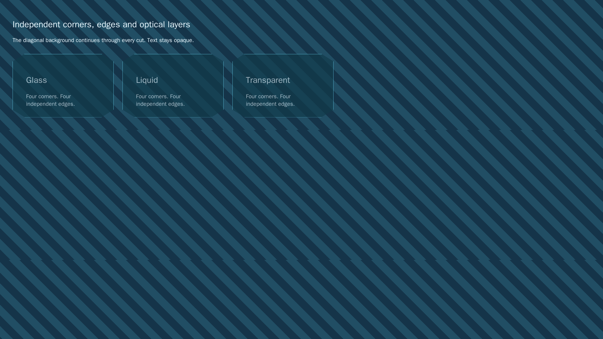
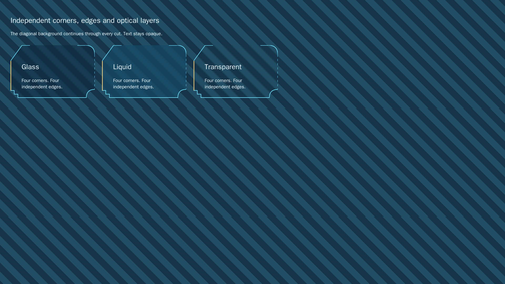

# Issue 211 implementation and verification inventory

[Issue 211](https://github.com/link-foundation/ui/issues/211) proposes public
network geometry/export/solver providers and declarative independent frames,
plus optical material hooks. [PR 217](https://github.com/link-foundation/ui/pull/217)
implements these framework extension points. It remains draft because exact
consumer parity and replacement of the consumer backends are **unfinished**.

## Plan and status

1. Read repository rules, the entire issue and comment, PR 217 conversation,
   inline comments and reviews, migration issue 66 and the latest consumer PR 55.
   Done. There are no required sub-issues or explicit dependency section in 211.
   The consumer's licensing prerequisite in 66 still applies to moving code.
2. Freeze provider, frame and material contracts in focused regressions. Done:
   new test files failed with missing-module errors before implementation;
   the existing network tests also pass afterward.
3. Implement framework interfaces without copying the consumer. Done for the
   extensions below. No consumer geometry, shader, sound engine, palette tables,
   tests, assets or screenshots were copied.
4. Review original framework visual example, run focused browser/accessibility
   checks, run all required gates, review the complete diff and push one batch.
   Verification results are recorded in the pull request.
5. Check all CI at the pushed revision. Leave exact consumer criteria unfinished
   and the PR draft until they can actually be verified. Do not merge or release.

## Requirements mapped to evidence

| Issue requirement                                                                                                        | Implementation and verification                                                                                                                                                  | Status                                                       |
| ------------------------------------------------------------------------------------------------------------------------ | -------------------------------------------------------------------------------------------------------------------------------------------------------------------------------- | ------------------------------------------------------------ |
| Public geometry/export/solver providers                                                                                  | `presentation.js`; `presentation.test.js`: same solved frame for preview/raster, late-job cancellation, snapshot isolation, lossless LiNo options, index above safe Number range | Implemented                                                  |
| Preserve user options across network sizes and synchronize history/styles                                                | Partial `update` retains options; committed snapshots feed host persistence/history via subscriptions                                                                            | Framework contract implemented; consumer adoption unverified |
| Solver-pinned exports                                                                                                    | Frame carries `positions`, `pins`, `bounds` and additional cloneable provider data; element preview/export and `toLino` retain solved pins                                       | Implemented                                                  |
| SVG/PNG/JPEG/WebP                                                                                                        | `networkToRaster`, same-frame custom raster hook; matte and bounded allocation tests                                                                                             | Implemented                                                  |
| Per-corner shape, pixel size, width/height and stroke; per-edge style/stroke/color                                       | `readFrames`, `resolveFrame`, `frameGeometry`; independent contour and transparent strokes                                                                                       | Implemented in new API; legacy helper retained               |
| Hover/active/selected states and independent panel/control/button/field/tab/chip/menu/nav/subnav/table inheritance       | Declarative vocabulary in `docs/spec/frames.md`; state/level inheritance and cycle regressions                                                                                   | Implemented                                                  |
| Tiny element fitting and transparent cuts independent of material                                                        | Uniform fit factor; original glass/liquid/inherited-material composition; browser structure/accessibility/screenshot test                                                        | Implemented; exact consumer pixel comparison unverified      |
| Material shader/noise hooks, opacity and surface inheritance                                                             | Material custom properties, backdrop blur and a shared effect governor; no content opacity or opaque corner overlays                                                             | Hook contract implemented; consumer shader parity unverified |
| Presets preserve motion/sound/volume/transparency choices                                                                | `applyAppearancePreset`, `materialStyle`; comfort and governor tests                                                                                                             | Implemented                                                  |
| Reusable animation governor and sound-control contracts                                                                  | Idle scheduler, visibility/reduced-motion cancellation, host sound sink and bounded volume                                                                                       | Implemented; consumer engine integration unverified          |
| Continuous cubic links, own-middle anchors, symmetric double loops, nine independent marker shapes, compensated tips     | Provider can retain these backend data and render them unchanged; default framework renderer is not replaced                                                                     | Exact implementation/parity unfinished                       |
| Independent turns/four gaps, anchored/neutral/fixed/mirrored/free ends, loop bends, aspect/order/spacing and fit margins | Arbitrary LiNo options pass through without narrowing; geometry and solving delegated to an explicit host adapter                                                                | Exact implementation/parity unfinished                       |
| Turns-before-gaps collision policy and painted marker clearance                                                          | Solver provider contract carries arbitrary solver data and cancellation                                                                                                          | Exact implementation/parity unfinished                       |
| Caption notations, fonts/cards/borders/dimensions and exact consumer preview/export pixels                               | SVG/raster provider owns the complete prepared scene; default encoder uses its SVG                                                                                               | Exact consumer contract unfinished                           |
| Twelve complete consumer dark/light palettes and optical presets                                                         | Existing shipped themes are preserved                                                                                                                                            | Exact palette import/parity unfinished                       |

The tests use mock providers to test the bridge contract. They **do not** simulate
or claim consumer geometry, collision, pixel or sound-engine parity. There is no
fabricated green consumer conformance suite.

## External evidence and licensing boundary

On 2026-11-06, `gh api repos/konard/konard.github.io/license` returned HTTP 404.
The main tree contains no LICENSE file. Repository policy in
[`docs/licensing.md`](../../licensing.md) explicitly lists konard.github.io as
**Denied** until the owner relicenses it: “Nothing may be copied from it.”
The issue itself also says no unlicensed site code is copied upstream.

[Consumer PR 55](https://github.com/konard/konard.github.io/pull/55) retains its
custom frames, geometry, exports and audio as compatibility adapters. Its current
description explicitly leaves upstream replacement and owner licensing unfinished.
This PR supplies extension points for those adapters; it cannot honestly certify
exact consumer behavior from the bridge tests alone. The remaining implementation
and conformance entries above are unfinished, even if framework CI is green.
An owner licensing decision or a separately verified independent replacement is
needed before copying or deleting those implementations. This is not a request
to waive the parity criteria or to merge a partial migration.

## Original visual example

These compare the framework's existing shared-corner helper with an original
independent-frame composition, **not** the consumer website. The background
continues through cutouts; material opacity does not fade the content.

