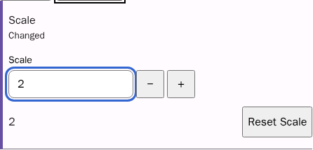
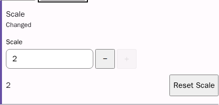
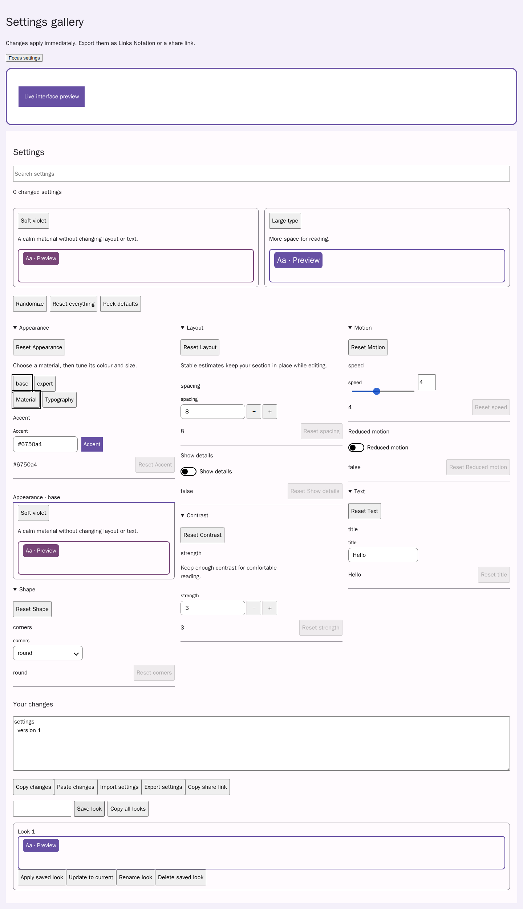
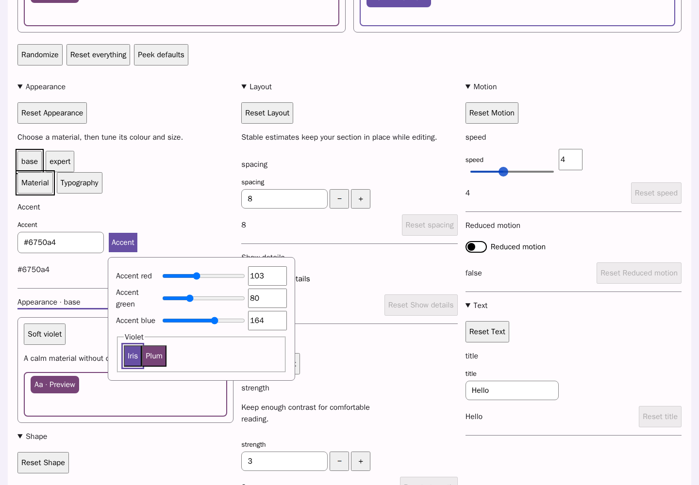

# Settings gallery and shared looks

[Issue #231](https://github.com/link-foundation/ui/issues/231) describes behaviour
only. This implementation uses the upstream controls and copies no consumer code.
There are no blocking dependencies or required sub-issues in the request.

## Using the gallery

Open [the runnable gallery](../../../packages/ui-components/examples/settings-gallery.html)
through `node scripts/serve-static.mjs --port 4173`. Its schema demonstrates:

```lino
appearance: section
  label Appearance
  tabs Material Typography
  levels base expert
  preview material
  presets soft
  extra-height 80
weight:
  type number
  default null
  section appearance
  level expert
  inherit true
  fallback 4
  min 0
  max 10
speed:
  type range
  default 4
  min 0
  max 10
  random not-heavier-than-default
preset soft
  label Soft
  description 'Only change the weight'
  partial
  set weight 2
```

`random` also accepts nested `min` and `max` clauses. Bounds intersect the field
range and retain its original step grid. Comfort and locked fields remain intact.
Whole presets keep their previous defaults-based behaviour; `partial` opts into
changing only listed fields. A section's `presets` lists card ids.

```js
const panel = createSettingsPanel(schema, {
  target,
  columns: { count: 3, balance: 'estimate' },
  presets: { display: 'cards' },
  peek: 'toggle',
  onChangedCount: (count) => updatePageHeader(count),
  looksStorageKey: 'my-app.looks.v1',
  sharedHash: location.hash,
  mountMiniature({ container, values, preset, look }) {
    return renderSample(container, values); // update(values), destroy()
  },
  mountPreview({ container, section, field, level, values }) {
    return renderPreview(container, values); // update(values, definition, level)
  },
});
persistLayer(config, 'user', localStorage, 'my-app.settings', { sync: true });
```

Column assignments are made once, using defaults and first tabs/levels. Search,
conditions and edits only change visibility. Conditional sections follow their
controller. `extra-height` accounts for custom preview content. Existing numeric
`columns` keeps its grid layout. `setSectionLevel(id, level)` changes one section;
`setLevel(level)` remains the panel-wide fallback. Untagged fields appear at all
levels/tabs. A level owns a value when a field assigned to it is non-null.

`mountMiniature` renders application samples; the built-in sample uses the panel's
projection. Preset samples recompute against current values. Section previews
require a `preview` clause and receive the active section level on every refresh.

Saved looks use versioned settings documents inside a nested LiNo `looks`
collection. `saveLook()`, `renameLook`, `deleteLook`, `exportLooks` and `importText`
provide the same actions as the cards. Names are trimmed and limited to 60
characters; collisions replace. `looksStorage` accepts injected storage or `null`
for host-managed persistence with `onLooksChange`. Storage errors appear in the
localized status. Existing settings import/export and comfort protection remain.
`applyShared` saves the previous look before applying, then removes the hash. Bind
persistent settings to retain the applied values after reload. Restore the saved
“Before the link” card after reload using Apply or `restoreBeforeLink()`.

For colours, set `mode popover`. `palettes` holds groups with `name` and `colors`,
whose entries have `name` and `hex`; the example shows the LiNo representation.
Programmatic schema properties also accept the equivalent object arrays. The
legacy flat `palette` and inline RGB modes continue to work. Popover text commits
only exact six-digit hex, while palette chips and sliders commit immediately.

## Verification map

| Requirement                                                                                        | Evidence                                                                           |
| -------------------------------------------------------------------------------------------------- | ---------------------------------------------------------------------------------- |
| Balanced, stable columns and dependent sections                                                    | Gallery browser height measurement and parent-identity assertions; panel unit test |
| ARIA tabs, empty tabs, per-section levels and sticky preview                                       | Keyboard/ownership unit tests; browser arrow navigation and axe audit              |
| Live preset miniatures, partial and scoped presets                                                 | Panel miniature test, ui-settings partial test, gallery section cards              |
| Saved cards, rename/collision, update/delete, localized names/empty state and persistence failures | Panel management/quota tests and browser copy/import/inline rename flow            |
| Shared safety, cleared hash, reload persistence                                                    | Browser share-link flow and panel quota guard                                      |
| Random bounds                                                                                      | 1000 deterministic draws on an offset step grid                                    |
| Cross-tab sync                                                                                     | Storage unit test plus two real browser pages, including reset                     |
| Popover placement/focus/dismissal, palettes and strict hex                                         | Browser popover test and open-dialog axe audit                                     |
| Number bounds, pointer focus and Shift stepping                                                    | Number regression tests and browser max-stepper assertions                         |
| Explicit number inheritance and blank drafts                                                       | Number regression test and browser reset/ownership flow                            |
| Toggle peek and public changed count                                                               | Panel callback/API test and browser floating-back flow                             |

Focused browser verification:

```sh
npx playwright test packages/ui-components/tests/e2e/settings-gallery.spec.js --project=chromium --workers=1
```

The data and number regression tests were run before implementation and failed,
then passed with the implementation. Repository checks run with `npm test`,
`npm run lint`, `npm run format:check` and `npm run check:duplication`.

## Review images

The number comparison uses the default branch control in the same gallery at its
maximum, followed by this branch's control. The increment button becomes disabled.
Recreate these with `node experiments/settings-gallery-screenshots.mjs` while the
static server is running. These are our own CC0-1.0 screenshots.

Before:



After:






