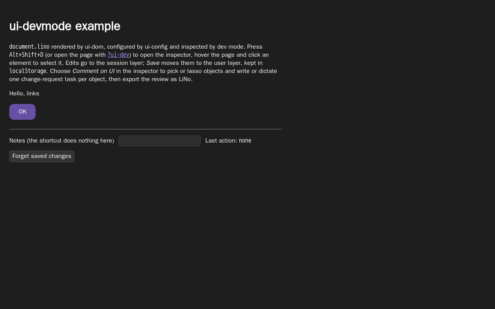
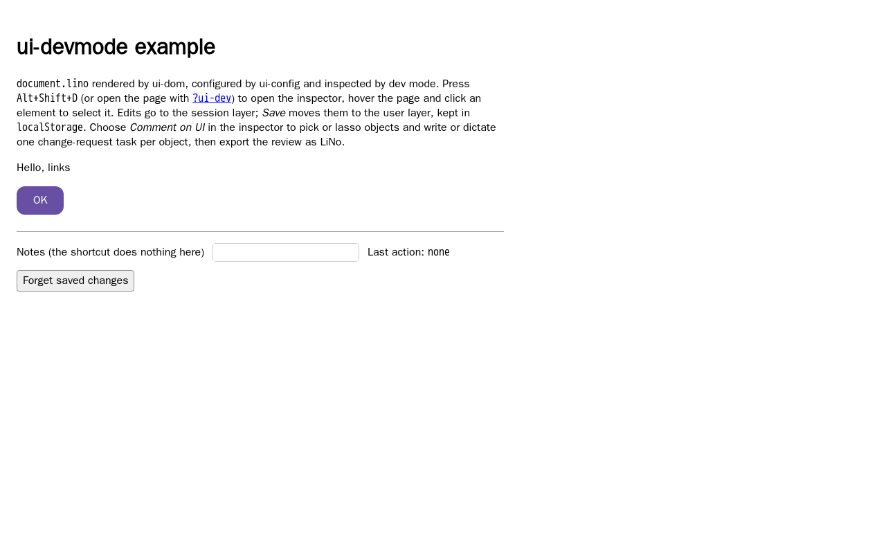

# WebKit native-button contrast investigation (#183)

## Finding

This is a native appearance/computed-style disagreement in the pinned WebKit,
not evidence that the settled dark button paints a silver surface. Axe correctly
reports the contrast of the computed colors it receives. Waiting for paint or
adding a delay does not correct those values. The example now owns this one
button's surface with `appearance: none`, an explicit `light-dark()` background,
`CanvasText`, and a visible border. It remains a native `<button type="button">`
with keyboard focus and the existing handler.

The original [failed workflow](https://github.com/link-foundation/ui/actions/runs/41768898989)
ran at `3c7724647115bce6ff756c68163dc9462fd2972e`. Both attempts report
`#ffffff` on `#c0c0c0`, 1.81:1 (log lines 973–1024 and 1066–1117), only on
`#forget`. Its downloaded trace confirms that the last main-page JPEG precedes
`axe.runPartial`; the trace does not contain a computed-style sample at that
instant. The issue's dark JPEG therefore cannot alone establish the cause.

The probe on this branch's unchanged example provides the missing simultaneous
evidence: computed styles, button screenshot, then axe, at initial load, after
two animation frames, and after a finite one-second delay. All three phases
produce the same computed colors and axe results in each scheme. The screenshot
pixel below is at (5, 5) inside the button crop, away from text and border.

| Example | Scheme | Computed foreground | Computed background | Painted background pixel | Axe ratio | Result    |
| ------- | ------ | ------------------- | ------------------- | ------------------------ | --------- | --------- |
| Before  | light  | rgba(0, 0, 0, 0.8)  | rgb(192, 192, 192)  | rgb(244, 244, 244)       | 8.31:1    | pass      |
| Before  | dark   | rgb(255, 255, 255)  | rgb(192, 192, 192)  | rgb(52, 52, 52)          | 1.81:1    | violation |
| After   | light  | rgb(0, 0, 0)        | rgb(239, 239, 239)  | rgb(239, 239, 239)       | 18.26:1   | pass      |
| After   | dark   | rgb(255, 255, 255)  | rgb(51, 51, 51)     | rgb(51, 51, 51)          | 12.63:1   | pass      |

Before, `appearance` is `auto`; afterward it is `none`. `color-scheme` remains
`light dark`. The dark native surface visibly has light text on dark gray,
contrary to the silver value. Both explicit surfaces now agree with computed
styles and pass the normal-text 4.5:1 requirement. No shared axe helper, comments
panel, inspector, audit scope, retries or synchronization was changed. No common
cause with #153 is assumed.

## Reproduce the bounded probe

Use the workflow image, pinned by digest:
`mcr.microsoft.com/playwright@sha256:b0ab6f3cb99aa7803adbc14d9027ec1785fc6e433b97e134e0f8fe61683b6b53`
(Playwright 1.59.1, Ubuntu Noble). Install with `npm ci --no-audit --no-fund`,
serve with `node scripts/serve-static.mjs`, then run inside that image:

```sh
node experiments/issue-183/native-button.mjs /tmp/native-button-evidence
```

It runs one browser with one page at a time, three finite samples per scheme,
and closes the browser in `finally`. It writes raw measurements and screenshots
to the chosen directory. The one-second delay is an investigation probe only;
the regression has no sleep or theme polling. Local Docker required
`--cgroupns host` for this nested container's cgroup configuration.

## Regression and retained results

`packages/ui-devmode/e2e/native-button.e2e.mjs` audits `#forget` with all shared
WCAG 2.2 A/AA tags. It requires zero violations, zero incomplete results, an
explicit passing contrast node for the button and a ratio of at least 4.5:1.
It retains computed styles, a rendered button image and full axe results in
Playwright attachments, then checks native type and keyboard focus.

Before the CSS change, the new regression reports **one passed (light), one
failed (dark)** with the original 1.81:1 violation. Afterward, the bounded command
below reports **six passed**, with one worker and no retries:

```sh
npx playwright test packages/ui-devmode/e2e/native-button.e2e.mjs --project webkit --repeat-each 3 --workers 1 --retries 0
```

| Run | Scheme | Result | Duration |
| --- | ------ | ------ | -------- |
| 1   | light  | passed | 5.2s     |
| 1   | dark   | passed | 3.3s     |
| 2   | light  | passed | 3.1s     |
| 2   | dark   | passed | 3.3s     |
| 3   | light  | passed | 3.3s     |
| 3   | dark   | passed | 3.7s     |

Total: **6 passed (33.3s)**. This is a retained local result in the pinned image;
full workflow results are linked in PR #196.

## Screenshots

These are full-page WebKit renders from the probe, before and after the CSS
change. The visible change is deliberately small: the important correction is
that the computed background now matches the rendered background.

| Before (dark)                                            | After (dark)                                           | After (light)                                            |
| -------------------------------------------------------- | ------------------------------------------------------ | -------------------------------------------------------- |
|  |  |  |
