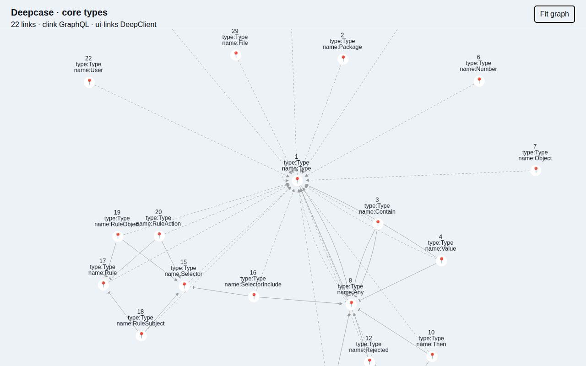

# Deepcase on clink

This runs the published Deepcase main graph (`CytoGraph` from
`@deep-foundation/deepcase@0.0.135`) and the original deeplinks React hooks
(`@deep-foundation/deeplinks@0.0.620`) through ui-links' `createDeepClient`.
`bridge.js` supplies Apollo's request interface using this adapter's select
and subscribe methods. The graph component and React hooks come from the
upstream releases; they are not reimplemented here.
No original DeepClient is instantiated and no database responses are mocked.

From the repository root, after `npm ci`:

```sh
# Browser dependencies are isolated from ui-links' runtime dependencies.
npm --prefix examples/deepcase ci --ignore-scripts --legacy-peer-deps
CARGO_BUILD_JOBS=1 cargo install link-cli --version 2.1.1 --locked
node examples/deepcase/build.mjs
node examples/deepcase/serve.mjs
```

Open the printed URL. Each run owns a fresh temporary clink database. The
setup downloads a pinned, recorded core export from
[link-cli](https://github.com/link-foundation/link-cli/blob/e183f0dbb891c0252c7aad53b47a454a8d848eaa/docs/protocol/graphql/deep-core.json)
(Unlicense), then creates ordinary demo package/type/name links for the
viewer's `Opened` and `OpenedHandler` lookups. These are schema data;
clink does not run Deep handlers or Deepcase's Next server routes.
The example shows 22 core types, using clink's guest token, native linked
values and a live WebSocket query.

```sh
npx playwright install chromium
CLINK=clink npx playwright test --config examples/deepcase/playwright.config.mjs
```

The check requires 22 actual Cytoscape nodes, writes and deletes a value through
the adapter, waits for each change in the graph label, and rejects browser
exceptions. It checks keyboard access to **Fit graph** and runs a WCAG axe audit;
the browser host labels the upstream file input. It saves
`test-results/deepcase-clink.png`. To refresh the reviewed
image, set `DEEPCASE_SCREENSHOT=docs/screenshots/deepcase-clink.png`.



Only the main graph is exercised here; editors, handlers and the full Next app
are outside this data API example. The browser host supplies a router context
and React lazy loading instead of Next's server runtime. Node-only file exports
and handler execution fail explicitly if requested.

`upstream.mjs` downloads five Unlicense source releases from npm, checks their
pinned SHA-512 integrity, and extracts them into ignored `dist/upstream`.
The build imports their main graph and hooks with only the browser dependencies
in this example's npm lockfile. It removes the graph module's unused import
and registration of `cytoscape-edge-connections` (AGPL), which Deepcase never
calls. Handler execution imports are replaced by an explicit unsupported
operation error. Neither that extension nor the unused server/editor dependency
tree is installed or bundled. The permissive `cytoscape-deep-d3-force@1.1.6`
release avoids its later, unnecessary webpack dependency; the example starts
with the Cola layout. Click **Fit graph** to arrange the types in a circle.

Deepcase, deeplinks, hasura, react-hasura and store use Unlicense. React,
Chakra, Apollo, esbuild and Playwright use MIT. Dependency licenses are checked
by `tests/security-workflow.test.js`; the Security workflow audits this lockfile.
The source archives and generated bundle are not committed.
