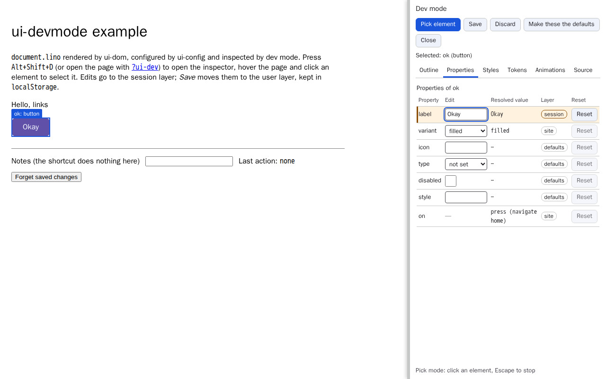
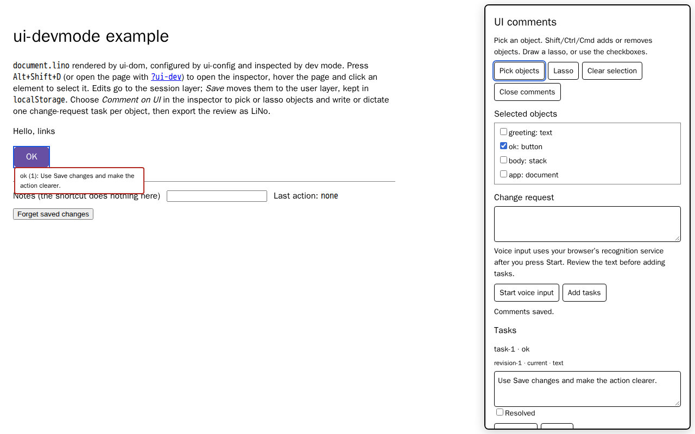

# @link-foundation/ui-devmode

The development/configuration mode of the framework: a runtime inspector over
any page rendered by [`@link-foundation/ui-dom`](../ui-dom/README.md). You
hover, select, inspect and edit every element of the page. Edits go only to the
`session` and `user` layers of
[`@link-foundation/ui-config`](../ui-config/README.md), never to the site
document.



```js
import { parse } from '@link-foundation/ui-core';
import { mountDocument } from '@link-foundation/ui-dom';
import {
  createConfig,
  persistSessionLayer,
  persistUserLayer,
} from '@link-foundation/ui-config';
import { mountDevMode } from '@link-foundation/ui-devmode';

const root = document.getElementById('app');
const { store, handle } = mountDocument(root, text, { styles, tokens });

const config = createConfig({ document: parse(text) });
persistUserLayer(config); // restores and keeps the saved edits
persistSessionLayer(config); // keeps the unsaved edits of this tab
config.bindStore(store); // the page follows the resolved configuration

mountDevMode({
  root,
  config,
  store,
  handle,
  styles,
  tokens,
  animations,
  policy: `(site-dev-mode: dev-mode
  (enabled true)
  (entry shortcut url-parameter element)
  (shortcut 'Alt+Shift+D')
  (write-layers session user)
  (locked-elements payment-form))`,
});
```

`mountDevMode` itself is small: it reads the policy and installs the entry
points. The overlay, the inspector and the model are loaded with a dynamic
`import()` the first time dev mode opens. With `(enabled false)` they are never
requested.

External Vite applications can dynamically import
`@link-foundation/ui-devmode/foreign` and call `mountForeignDevMode()` without
conversion aliases or source transforms. The inspector layout and agent
instruction template use static `new URL(..., import.meta.url)` references;
Vite includes them in production output, including builds hosted at a subpath.
Native Node ESM still reads these assets from disk.

## Opening dev mode

| Entry point     | How                                                                                                                    |
| --------------- | ---------------------------------------------------------------------------------------------------------------------- |
| `shortcut`      | `Alt+Shift+D` (matched on `event.code`, so it works on every layout) toggles dev mode; ignored while typing in a field |
| `url-parameter` | `?ui-dev` opens dev mode on load (`?ui-dev=false`, `0`, `off`, `no` do not)                                            |
| `element`       | a `<ui-dev-mode></ui-dev-mode>` element in the page opens dev mode                                                     |

## The site policy

The policy is a `dev-mode` link, read with ui-core `parse` (the official
Links Notation parser):

| Property          | Default                          | Meaning                                                                |
| ----------------- | -------------------------------- | ---------------------------------------------------------------------- |
| `enabled`         | `true`                           | `false` turns dev mode off: no entry point, no inspector module loaded |
| `entry`           | `shortcut url-parameter element` | the entry points that may open dev mode                                |
| `shortcut`        | `'Alt+Shift+D'`                  | the key combination                                                    |
| `write-layers`    | `session user`                   | the layers an edit may write; `user` is needed to Save                 |
| `locked-elements` | none                             | element ids that stay read-only, with their descendants                |

Unknown keys, entry points, layers and values are reported in
`policy.warnings` and ignored. `defaults`, `theme` and `site` are never
writable.

## The overlay

While dev mode is open, the element under the pointer is outlined and labelled
`id: type` (for example `ok: button`). A click selects it and is not delivered
to the app. Escape leaves pick mode, so the page works as usual again. A second
Escape closes dev mode. The boxes come from `getBoundingClientRect`, have
`pointer-events: none`, and have no transitions under
`prefers-reduced-motion: reduce`.

## The inspector

The inspector is docked to the right of the page inside a shadow root. It is
resizable with the pointer or the arrow keys on its WAI-ARIA window splitter.
Its layout is [`src/inspector.lino`](src/inspector.lino), rendered by ui-dom.
It follows `prefers-color-scheme`, and its texts come from a message table
(`messages` option) that pages can translate.

| Tab        | Content                                                                                                                         |
| ---------- | ------------------------------------------------------------------------------------------------------------------------------- |
| Outline    | a WAI-ARIA tree of the elements (`app > body > greeting, ok`); selecting a row selects the element                              |
| Properties | a grid `name, editor, resolved value, layer, reset`; changed rows (user or session layer) are marked; locked rows are read-only |
| Styles     | the style rules that match the selected element                                                                                 |
| Tokens     | the tokens the element uses, with their resolved values                                                                         |
| Animations | the animations that target the element                                                                                          |
| Source     | the Links Notation of the element                                                                                               |

The property editors are typed: text, number, boolean (a checkbox switch), enum
(select), colour, dimension (number and unit), token reference and read-only
values (actions).

| Action  | Effect                                                              |
| ------- | ------------------------------------------------------------------- |
| edit    | writes the `session` layer; the page updates at once                |
| Save    | moves the session overrides to the `user` layer, which is persisted |
| Discard | clears the `session` layer                                          |
| Reset   | removes the value from the highest writable layer that holds it     |

## Automation

While dev mode is open, `globalThis.linkUiDevMode` is
`{ select(id), getSelection(), setProperty(id, name, value), close() }`.
`setProperty` writes the session layer and throws a `DevModeError` (with a
`code`) for a locked element or a bad value. The handle is removed when dev
mode closes.

The pure model is exported as `@link-foundation/ui-devmode/model`
(`buildOutline`, `propertyRows`, `applyEdit`, `resetProperty`,
`saveSession`, `discardSession`). `applyEdit` throws for the `site`, `theme`
and `defaults` layers and for locked elements.

## Example

`examples/index.html` renders `docs/case-studies/issue-1/samples/document.lino`
with dev mode. Run `node scripts/serve-static.mjs` and open
`http://127.0.0.1:4173/packages/ui-devmode/examples/?ui-dev`. Add
`&policy=disabled` for a disabled policy, or `&lock=ok` to lock an element.

## Tests

- `tests/*.test.js` (`npm test`) cover the policy, the activation, the model,
  and the whole inspector in jsdom.
- `e2e/devmode.e2e.mjs` (`npm run test:ui`) covers the acceptance flow in
  Chromium and WebKit: entry points, the lazy loading under a disabled policy,
  pick mode, the outline, the edit, save, reload and reset flow, locked
  elements, and axe.

## License

[Unlicense](LICENSE)

## Make these the defaults and share a preview

The inspector's **Make these the defaults** button opens a modal with three
read-only fields: the LiNo overrides, a share link and an agent instruction.
Each has a Copy button; blocked clipboard access selects the text for manual
copy. Escape closes the dialog and returns focus to its button. Links above
8,192 characters cannot be copied; copy the LiNo field instead.

Extend the site's dev-mode policy with these optional fields:

```lino
site-dev-mode: dev-mode
  repository link-foundation/ui
  site-config site/config/site.lino
  comfort-keys motion.mode sound.on sound.volume
```

A valid repository enables a budgeted **Open as GitHub issue** link. Missing
instruction values are explicit `<unknown repository>` or `<unknown siteConfig>`
markers. The instruction template is shipped as `src/agent-instruction.txt`.

```js
import {
  applySharedOverrides,
  exportOverrides,
  shareUrl,
  parseDevModePolicy,
} from '@link-foundation/ui-devmode';
import { renderAgentInstruction } from '@link-foundation/ui-devmode/agent-instruction';

const policy = parseDevModePolicy(sitePolicyText);
const { text, links, count } = exportOverrides(config);
const { url, tooLong } = shareUrl(window.location, text);
const instruction = renderAgentInstruction({
  repository: policy.repository,
  siteConfig: policy.siteConfig,
  overrides: text,
});
const report = applySharedOverrides({
  config,
  policy,
  location: window.location,
  history: window.history,
  storage: window.localStorage,
  document: window.document,
});
```

Call `applySharedOverrides` after restoring writable layers and binding the
configuration to the renderer. It validates `#ui-overrides=` text, saves both
previous writable layers as a **Before the link** LiNo backup under
`ui-overrides:before-the-link`, overlays accepted changes into `session`,
removes the hash with `history.replaceState`, and shows the Keep/Discard banner.
Keep retains the session preview; Discard restores the previous session. User
and site layers are untouched. If backup storage fails, nothing is applied.

For pasted text, pass `text` to the same function; it uses identical validation
without changing the URL. `validateOverrides(text, { schema, policy })` is also
available independently. `schema` is a ui-core document or
`{ document, vocabulary }` for an extended dialect; the apply function defaults
to `config.effective()`. Include token/theme nodes in that configuration to
share token edits. Tokens must already exist; their existing scalar value
determines their type. Actions, unknown targets/properties, invalid values,
locked elements (including descendants), and declared comfort keys are rejected.
A comfort key matches a property name, `element.property`, or a token key.
Rejected links are reported in the banner and never evaluated. Input is limited
to 65,536 characters and depth 16 through the official parser.

`exportOverrides(config, { id, base, layers })` returns `{ text, links, count }`.
Only `user` and `session` layers are accepted; their effective difference from
site is sorted by element ID, property and token key. The codec exports
`encodeShareHash`, `decodeShareHash` (malformed hashes return `null`) and
`shareUrl` (`{ url, tooLong }`, including the full URL in its budget).

The runnable example is `packages/ui-devmode/examples/?ui-dev`.
`packages/ui-devmode/e2e/defaults.e2e.mjs` covers label editing, share preview,
Keep/Discard, clipboard fallback, modal keyboard use, axe and URL budgets.

## Foreign pages: bookmarklet and extension

Dev mode also works on pages that do not use ui-dom. The foreign adapter uses
`importDom` from ui-convert, keeps node mappings in a WeakMap, and never adds
mapping attributes to the page. The same inspector lives in a fixed shadow host.
Pick an element, open Properties, and edit leaf `text`, `attr <name>` or
`style <property>` rows. Existing attributes and inline declarations are listed;
`attr title` and `style color` are available even when absent. Arbitrary safe
properties can also be set with
`linkUiForeignDevMode.setProperty(id, 'style background-color', '#eef')`.
Event attributes, script URLs, `srcdoc`, and whole-style attribute writes are
refused. Text edits cannot replace an element's children. Closed shadow roots
stay opaque; cross-origin iframe contents are not inspected.

Changes write the session configuration layer and are automatically persisted
per origin and pathname as LiNo under `link-ui-devmode:<origin>:<pathname>`.
Reopening restores them; Save promotes the session to user and Discard removes
session edits. Reset restores the previous value, including an absent attribute.
DOM changes re-import after 200 ms; stable IDs keep their selection. Structural
IDs may change when siblings are inserted; use existing HTML IDs when possible.
Copy overrides as LiNo exports one `set` per changed property; Copy subtree as
LiNo exports the selected live subtree for migration. Clipboard denial presents
a selected textarea for manual copying. `whenSaved()` waits for pending writes;
`storageError` and `restoreError` expose unavailable storage or invalid data.

Build with `npm run build --workspace @link-foundation/ui-devmode`. It writes
`dist/foreign.js` (one ES module), `dist/devmode.js` (the extension bundle) and
`dist/bookmarklet.txt`. Set `UI_DEVMODE_BUNDLE_URL=https://your-host/foreign.js`
at build time to configure the bookmarklet loader. Host the ES module with a
JavaScript content type and CORS permission for the inspected origin. The default
URL reserves the future documentation hosting location; self-host the bundle
until that location is deployed. Drag a bookmark whose URL is the contents of
`bookmarklet.txt` into the bookmarks bar, then click it on the page to toggle.

**Strict Content Security Policy (CSP) blocks the bookmarklet**, including the
loader or its module request. Use the browser extension on these pages. The
`tests/fixtures/foreign-csp.html` fixture checks this with `script-src 'none'`.
The extension injects a packaged script in Chrome's isolated world and uses
`chrome.storage.local`; it does not fetch executable code from the web.
See [extension instructions](../ui-devmode-extension/README.md). Restricted
browser pages cannot be inspected. No Firefox support is claimed.

For programmatic use, import `mountForeignDevMode` from
`@link-foundation/ui-devmode/foreign`; pass an optional `window`, inspector
`layout` LiNo, or async `{ getItem, setItem }` storage wrapper. The returned
controller supports select, exportOverrides, exportSubtree, close/toggle and
async destroy. Repeated mounting toggles the existing controller.

## Comment on the UI

Press **Comment on UI** in the inspector to open per-object change requests.
Pick an object, add/remove objects with Shift/Ctrl/Cmd, draw a freehand **Lasso**,
or select checkboxes with the keyboard. Type an instruction or press **Start
voice input**, review its transcript, and press **Add tasks**. Each selected
object gets an independent task. Open tasks appear in anchored comment bubbles
and the task panel; edit and save their instructions, resolve/reopen, or delete
them. Escape cancels a gesture, then leaves picking, then closes comments.
Closing comments returns to the inspector. Closing dev mode cleans up both.

**Export LiNo** fills the handoff field; **Copy LiNo** uses the clipboard or
selects the text for manual copying. Paste a review and press **Import LiNo**
to replace it after validation. Requests include exact canonical UI snapshots,
per-object target IDs, input method, status and ordered create/update/remove
history. `current`, `outdated` and `missing` indicators prevent stale requests
from looking current. Comments never execute patches or change the app.
The [format specification](../../docs/spec/comments.md) describes all fields,
validation, budgets and agent consumption.

The review persists as LiNo in localStorage under
`ui-comments:<pathname>` by default. `commentOptions` passed to `mountDevMode`
can set `storage` (`null` disables persistence), `storageKey`, initial `text`,
`messages` (English text to translation) and `trace(event, detail)` (off by
default). Multiple mounts on one path should use distinct keys. Storage errors
remain visible and leave in-memory tasks exportable. Imported reviews may refer
to older UI; the panel retains them and marks them accordingly. Comments can
refer to locked elements without changing the site's editing permissions.

The same panel works with the foreign-page bookmarklet/extension and the
WYSIWYG designer. A custom renderer with a stable-ID tree can mount it directly:

```js
import { mountComments } from '@link-foundation/ui-devmode/comments';

const comments = mountComments({
  root,
  tree: store,
  nodeFor: (id) => handle.nodeFor(id),
  storageKey: 'my-page.comments',
});
comments.select(['ok', 'greeting']);
comments.model.add(comments.selection(), 'Make this easier to understand');
const handoff = comments.model.export();
comments.destroy();
```

The pure exports are `createComments({ getDocument, text?, trace? })`,
`readComments(text)`, `commentDocument(tree)`, `COMMENT_LIMITS` and `lasso`.
The model exposes `tasks`, `revisions`, `events`, `add`, `update`, `remove`,
`state`, `export`, `import` and `subscribe`. Returned lists are copies.
`commentDocument` creates a named snapshot from a store-shaped tree. The mount
also exposes `host`, `tree`, `select`, `selection`, `refresh` and `destroy`.
Pass `observe` for adapters whose change subscription is separate from `tree`.
All model operations are synchronous and deterministic.

Voice input uses an optional browser service only after Start; availability,
permissions, language support and service connectivity depend on the browser.
The page language selects recognition language. Text entry remains available
when recognition is absent or denied; no microphone or service is required for
the rest of the workflow.



Tests: `node --test packages/ui-devmode/tests/comments*.test.js` and
`npx playwright test packages/ui-devmode/e2e/comments.e2e.mjs --workers=1`.
The browser suite covers text/voice tasks, freehand gestures, validation,
persistence, designer integration, and light/dark WCAG 2.2 AA. Set
`COMMENT_SCREENSHOTS=1` to refresh the two Chromium documentation images.

Foreign-page comments use the same storage channel as overrides, with a separate
origin/path key: local storage for a bookmarklet, `chrome.storage.local` in the
extension. `whenSaved()` waits for both writes; asynchronous storage failures
appear in the panel and `storageError`. Comment source snapshots retain the
imported page IDs and never apply DOM edits.
