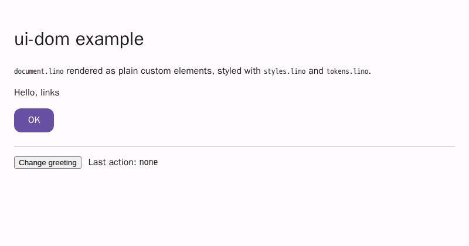

# @link-foundation/ui-dom

The reference DOM renderer of the associative UI framework. A
[`@link-foundation/ui-store`](../ui-store/README.md) document renders as
plain custom elements in the light DOM (`ui-document`, `ui-stack`,
`ui-text`, `ui-button`, `ui-image`), each carrying the stable store ID of
its element in `data-link-id`. The renderer then follows the store: every
committed transaction becomes an incremental patch of the affected nodes
only, applied in one microtask.

Styles come from [`ui-style`](../ui-style/README.md) rules and
[`ui-tokens`](../ui-tokens/README.md) CSS custom properties, adopted once
per root. `(on press (navigate home))` handlers are data: they dispatch a
`ui-action` event and never run code. `renderToHTML` writes the same
markup as a static HTML string.

There is no runtime dependency but the workspace packages (`ui-core`,
`ui-store`, `ui-style`, `ui-tokens`) and, through ui-core,
`links-notation`.

```js
import { mountDocument } from '@link-foundation/ui-dom';

const { store, handle } = mountDocument(
  document.getElementById('app'),
  `(app: document
  (theme material3)
  (body: stack
    (direction vertical)
    (gap (token space.medium))
    (greeting: text 'Hello, links')
    (ok: button (label 'OK') (variant filled) (on press (navigate home)))))`,
  {
    tokens: tokensLino, // ui-tokens LiNo text
    styles: stylesLino, // ui-style LiNo text
    onAction: (detail) => console.log(detail),
    // { source: 'ok', event: 'press', action: ['navigate', 'home'] }
  }
);

store.setProp('greeting', 'value', ['Hello again']); // one patch, one node
handle.nodeFor('ok'); // <ui-button data-link-id="ok" variant="filled">
```

renders

```html
<ui-document data-link-id="app" theme="material3">
  <ui-stack
    data-link-id="body"
    style="flex-direction: column; gap: var(--space-medium);"
    direction="vertical"
  >
    <ui-text data-link-id="greeting">Hello, links</ui-text>
    <ui-button data-link-id="ok" variant="filled">
      <button type="button">OK</button>
    </ui-button>
  </ui-stack>
</ui-document>
```

The example page [`examples/ui-dom/`](../../examples/ui-dom/) mounts the
issue-1 samples in a browser:

```bash
node scripts/serve-static.mjs   # then open http://127.0.0.1:4173/examples/ui-dom/
```



## Decision: plain custom elements, light DOM

- **Plain custom elements, no Lit or other runtime.** Each kind is a
  `customElements.define(tag, class extends HTMLElement {})`; the renderer
  creates and patches the nodes itself from store events, so a component
  library or a template compiler adds nothing but weight. Lit (BSD-3-Clause)
  was studied and not used, to keep zero runtime dependencies besides the
  workspace packages (research "Recommendations" A.2 and C of
  [existing-solutions.md](../../docs/case-studies/issue-1/research/existing-solutions.md)).
  A tag is defined only when `customElements.get(tag)` is undefined, so a
  second copy of the package, or a page that defined the tag first, is safe.
- **Light DOM, no shadow root per kind.** Page CSS, the adopted stylesheet,
  dev mode (which reads `data-link-id` from any node) and native form
  participation of the inner `<button>` all work with ordinary DOM queries
  and selectors. Shadow DOM per kind may be added later, kind by kind; a
  render into a shadow root container already works (the sheet is adopted
  on that root).
- **State as attributes and CSS variables.** Style-relevant properties are
  mirrored as attributes (`variant="filled"`) and token values are CSS
  custom properties, so a theme switch only swaps variables, as the
  konard.github.io and immortality projects do for plain JS, React and Vue.

## API

### `render(container, store, options?)`

Renders every element of the store into `container` (roots in document
order) and subscribes to the store. Returns a handle:

| Member        | Description                                                                    |
| ------------- | ------------------------------------------------------------------------------ |
| `nodeFor(id)` | the node of a store ID, or `null`                                              |
| `idFor(node)` | the store ID of a node or of its closest rendered ancestor, or `null`          |
| `flush()`     | apply the queued store events now (synchronously); returns how many there were |
| `destroy()`   | remove every node, the store listener and the stylesheet (idempotent)          |
| `store`       | the store                                                                      |
| `diagnostics` | the diagnostics of the first render (later ones go to `onDiagnostic`)          |
| `styles`      | `{ sheet?, element?, release() }` of the stylesheet, or `null`                 |

For every store ID, `handle.idFor(handle.nodeFor(id)) === id`. The IDs are
kept in a `Map` (ID → node) and a `WeakMap` (node → ID). Anonymous elements
carry their generated store ID (`_1`, …). The inner native `<button>` of a
`ui-button` and the `` of a `ui-image` are parts of their element and
carry no `data-link-id` of their own, so `[data-link-id="ok"]` matches
exactly one node.

| Option                 | Description                                                                         |
| ---------------------- | ----------------------------------------------------------------------------------- |
| `kinds`                | kind renderers of this render (a `Map` or an object), looked up before the registry |
| `onAction(detail, ev)` | called for every action after the `ui-action` event is dispatched                   |
| `onDiagnostic(d)`      | called with every diagnostic                                                        |
| `onPatch(events)`      | called once per applied patch with its store events                                 |
| `setTitle`             | `true` sets `document.title` from the document's `title`                            |
| `tokens`               | ui-tokens LiNo text, `{ sets }` of `readTokens`, or resolved tokens                 |
| `theme`                | the token set (default: the document's `theme`, then the first set)                 |
| `styles`               | ui-style LiNo text, or the rules of `readStyles`                                    |
| `css`                  | extra CSS appended to the sheet                                                     |
| `prefix`               | the CSS custom property prefix (`md` gives `--md-color-primary`)                    |
| `baseCss`              | `false` leaves out the base rules                                                   |
| `adoptStyles`          | `false` applies no stylesheet                                                       |

### `mountDocument(container, text, options?)`

Parses Links Notation with ui-core (`options.parseOptions`), creates a
store with ui-store (`options.storeOptions`) and renders it. Returns
`{ store, handle, diagnostics }`, the diagnostics of the parser and the
first render.

### Incremental updates

The store calls its listener once per committed transaction. The events
are queued and applied in one microtask, so 1,000 updates in one
transaction, or several transactions in one task, are one patch.

| Store event | DOM change                                                                     |
| ----------- | ------------------------------------------------------------------------------ |
| `insert`    | create the node, set `data-link-id`, insert it at its index among its siblings |
| `update`    | the same node; the kind `update` receives only the changed property names      |
| `remove`    | the kind `destroy`, remove the node, drop both map entries (children first)    |
| `move`      | `insertBefore` at the new index; the node keeps its identity                   |
| `rename`    | rewrite `data-link-id` and both maps                                           |

An event that does not match the rendered tree is reported as a `bad-event`
diagnostic; it never throws.

### Events

`(on EVENT ACTION ARG...)` listens to the DOM event of `EVENT` on the
kind's event target (the native `<button>` of a `ui-button`, so Enter and
Space work as clicks) and dispatches

```js
new CustomEvent('ui-action', {
  bubbles: true,
  composed: true,
  detail: { source: 'ok', event: 'press', action: ['navigate', 'home'] },
});
```

on the element node, then calls `options.onAction(detail, event)`.
`source` is the current store ID (it follows renames).

| `EVENT` | DOM event      |
| ------- | -------------- |
| `press` | `click`        |
| `focus` | `focusin`      |
| `blur`  | `focusout`     |
| `hover` | `pointerenter` |

Handlers are data: the source contains no `eval` or `new Function`, no
`on*` attribute is ever set (a kind cannot list one in `attributes`), and
the action is passed on as names and values for the application to
interpret. A `navigate` target such as `javascript:…` is reported as
`unsafe-url`; an image source with a `javascript:`, `data:` or `vbscript:`
scheme is not set.

### `renderToHTML(source, options?)`

Static HTML of a document with the same tags and `data-link-id` attributes
(no hydration). `source` is LiNo text, a store, a ui-core document, a node
or a list of nodes; `options` takes `kinds`, `onDiagnostic` and `prefix`.
Text and attribute values are escaped (`& < > " '`), and no `on*`
attribute or `<script>` element is ever written, even by a custom kind.
Also available as `@link-foundation/ui-dom/html`.

### Styles

One stylesheet per render, in this order:

1. `BASE_CSS`: zero-specificity (`:where`) layout rules of the basic kinds,
   a visible focus ring and the disabled state;
2. the token CSS custom properties (`:root, :host { --color-primary: … }`)
   of the theme set;
3. the compiled style rules (`ui-button[variant='filled'] { background-color:
var(--color-primary); }`);
4. `options.css`.

The sheet is adopted (`adoptedStyleSheets`) on the root node of the
container, a document or a shadow root, once per root: renders that share
a root and the same CSS share one sheet, removed when the last of them is
destroyed. Without `adoptedStyleSheets` one `<style data-ui-dom>` element
is used instead. `buildCss(options, theme?)` returns the CSS text.

## Kind registry

```js
import { defineKind } from '@link-foundation/ui-dom';

defineKind('asset', {
  tag: 'ui-asset',
  attributes: { license: 'string' }, // mirrored for CSS selectors
  create: (el, ctx) => ctx.document.createElement('ui-asset'),
  update(node, el, changed, ctx) {
    if (changed.includes('source')) {
      node.textContent = el.props.get('source')?.[0] ?? '';
    }
  },
});
```

| Spec field     | Description                                                                                  |
| -------------- | -------------------------------------------------------------------------------------------- |
| `tag`          | a valid custom element name; defined on first use per window                                 |
| `create`       | build the node; `update` then runs with every property                                       |
| `update`       | apply the changed properties (`changed` lists their names)                                   |
| `childrenSlot` | where the children go: a function of the node (default: the node itself), or `null` for none |
| `eventTarget`  | the element the `(on ...)` listeners go on (default: the node)                               |
| `attributes`   | `{ name: 'string' \| 'boolean' }` properties mirrored as attributes; `on*` names are refused |
| `destroy`      | called before the node is removed                                                            |

The element model `el` has `id`, `name`, `kind`, `positional`,
`properties`, `unknown` and `props`: a `Map` of every property by name,
where the positional values take their ui-core vocabulary names (`value` of
a `text`, `label` of a `button`, `source` of an `image`) and named
properties override them. `ctx` has `document`, `options` and
`diagnostic(code, severity, at?)`.

The `kinds` render option overrides the registry for one render. A kind
without a renderer renders as `<ui-unknown data-kind="…">` (its children
still render inside it) with an `unknown-kind` warning; a renderer that
throws is reported as `kind-error` and the element falls back to
`ui-unknown`. Rendering never throws for document content.

### Basic kinds

| Kind       | Element                           | Properties                                                                                                      |
| ---------- | --------------------------------- | --------------------------------------------------------------------------------------------------------------- |
| `document` | `ui-document`                     | `theme`, `lang` (attributes); `title` sets `document.title` only with `setTitle: true`                          |
| `stack`    | `ui-stack`                        | `direction` (`flex-direction`), `gap`, `padding` (typed by ui-style, tokens as CSS variables), `align`          |
| `text`     | `ui-text`                         | `value` (the positional text) as a text node                                                                    |
| `button`   | `ui-button > button[type=button]` | `label`, `variant` (attribute), `disabled` (attribute and native `disabled`)                                    |
| `image`    | `ui-image > img`                  | `source` (`src`; unsafe schemes are refused), `alt` (`alt=""` and `missing-alt` when absent), `width`, `height` |

## Diagnostics

`{ code, severity, message, at }`, as in ui-core; `at` names the `element`
(store ID) and `kind`.

| Code              | Severity | When                                                                  |
| ----------------- | -------- | --------------------------------------------------------------------- |
| `unknown-kind`    | warning  | no renderer for the kind; rendered as `ui-unknown`                    |
| `kind-error`      | error    | a kind renderer threw                                                 |
| `missing-alt`     | warning  | an `image` without `alt` (rendered with `alt=""`)                     |
| `unsafe-url`      | error    | a `javascript:`, `data:` or `vbscript:` URL in a source or `navigate` |
| `invalid-handler` | error    | an `(on ...)` without an event and an action name                     |
| `unknown-event`   | warning  | an `(on EVENT ...)` event without a DOM mapping                       |
| `unknown-action`  | warning  | an action that is not a name                                          |
| `invalid-value`   | error    | a `stack` `direction`, `gap` or `padding` value of the wrong type     |
| `bad-event`       | error    | a store event that does not match the rendered tree                   |

## Tests

```bash
node --test packages/ui-dom/tests/*.test.js
npx playwright test packages/ui-dom/e2e
```

The unit tests run in [jsdom](https://github.com/jsdom/jsdom) (MIT, a dev
dependency), a fresh window per test. `UPDATE_SNAPSHOTS=1` rewrites
`tests/__snapshots__/document.html`. The Playwright check opens the example
page, asserts that `[data-link-id="ok"]` is visible with the token colour,
clicks it, changes the greeting, runs axe-core and attaches a screenshot.

## License

[Unlicense](LICENSE) (public domain).
