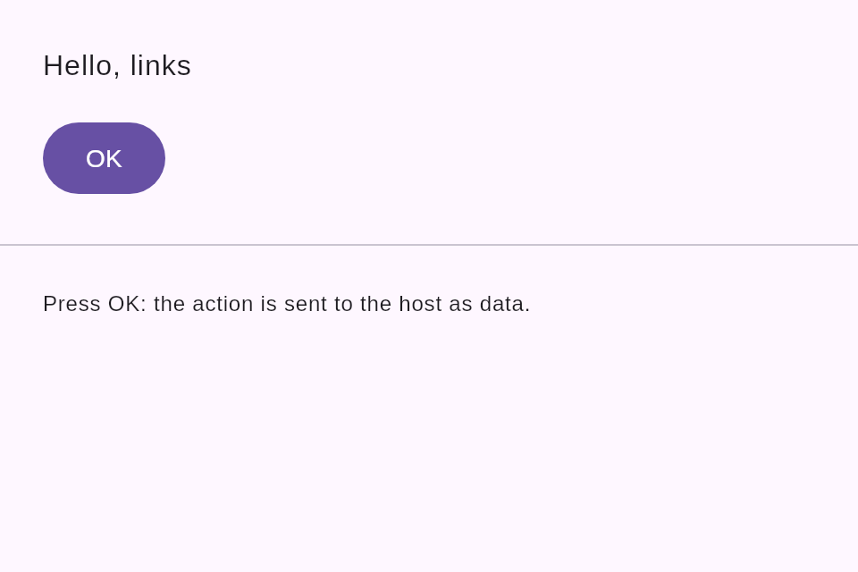
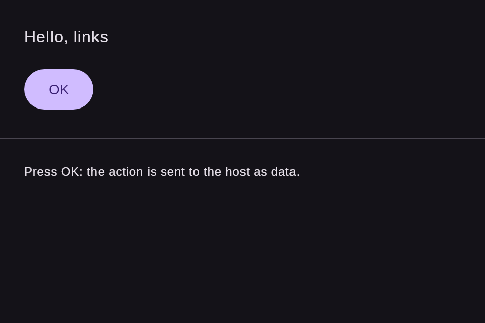

# ui-kotlin

The Jetpack Compose / Compose Multiplatform renderer of the UI dialect
(`ui-dialect/0`, issue #32). `UiView` draws a Links Notation document with
Material 3 components. It reads the same documents and passes the same
shared fixtures (`docs/spec/fixtures`) as the JavaScript packages and the
Swift port (#30).

It is a Gradle Kotlin Multiplatform project:

- `jvm("desktop")`: the target that CI builds and tests.
- Android: a library target that is configured only when an Android SDK is
  found (`ANDROID_HOME`, `ANDROID_SDK_ROOT` or `sdk.dir` in
  `local.properties`), so a machine without one still builds the desktop
  target.

The Links Notation parser is the Kotlin port of issue #31
(`native/kotlin/links-notation`), an included build. Documents are never
read with regular expressions.

```sh
cd packages/ui-kotlin
./gradlew check                                    # every test
./gradlew desktopTest --tests '*FixtureTest*'      # the shared fixtures only
UPDATE_SNAPSHOTS=1 ./gradlew desktopTest --tests '*FixtureTest*'   # write missing snapshots
```

## Usage

```kotlin
val document = rememberUiDocumentState(File("document.lino").readText())

UiView(
    document,
    theme = UiTheme.Default,                       // or UiTheme.fromLino(text, mode = "dark")
    onAction = { action -> println(action) },      // UiAction("ok", "press", listOf("navigate", "home"))
    imageLoader = { url -> null },                 // optional: a Painter for an image URL
    onDiagnostics = { diagnostics -> /* log */ },  // projection and render-tree diagnostics
)

document.setProp("greeting", "value", "Bye")       // redraws only that element
```

| API                                           | What it does                                                                                                                    |
| --------------------------------------------- | ------------------------------------------------------------------------------------------------------------------------------- |
| `parseDocument(text)`                         | Parses with the #31 parser and projects to the element tree of `docs/spec/projection.md` (`UiDocument`, the `.tree.json` shape) |
| `UiDocumentState(text)`                       | One `mutableStateOf` per element: `setProp(id, name, values)` recomposes only that element                                      |
| `renderTree(document, theme)`                 | The platform-neutral render tree that `UiView` draws, with its diagnostics                                                      |
| `dumpLino(tree)`                              | The render tree as Links Notation (the snapshot format), written with the #31 formatter                                         |
| `UiTheme.Default`                             | The design tokens generated by `@link-foundation/ui-tokens` (#19), in `tokens/Tokens.kt`                                        |
| `UiTheme.fromLino(text, setId, mode, base)`   | A theme `.lino` read at run time: `(extends ...)`, `(or ...)`, `(mode dark ...)`; problems are diagnostics                      |
| `UiView(document, modifier, theme, onAction)` | The composable                                                                                                                  |

## Mapping

The mapping and the render-tree format follow the Swift port (#30). Every
node gets `Modifier.testTag(id)`.

| kind       | Compose                                                                                                      | render tree                                                        |
| ---------- | ------------------------------------------------------------------------------------------------------------ | ------------------------------------------------------------------ |
| `document` | scrollable `Column`; `title` is the pane title                                                               | `Column (scroll vertical)`                                         |
| `stack`    | `Column` / `Row` with `Arrangement.spacedBy(gap)`                                                            | `Column` or `Row`; `(spacing N)`, `(padding N)`, `(alignment ...)` |
| `text`     | `Text`                                                                                                       | `Text 'value'`                                                     |
| `button`   | `Button` (`OutlinedButton`, `TextButton` for `variant`), role `Button`                                       | `Button (label L)`, `(variant outlined\|text)`, `(disabled true)`  |
| `image`    | `Image` from the `imageLoader`, or an empty `Box` of its size; role `Image`, `contentDescription` from `alt` | `Image (url U) (width N) (height N) (alt A)`                       |
| any other  | an empty `Box` and an `unsupported-kind` diagnostic; its children are not drawn                              | `Box`                                                              |

Alignments are `Start`, `CenterHorizontally` and `End` in a column, and
`Top`, `CenterVertically` and `Bottom` in a row. Dimensions are `dp`: a
token reference such as `(gap (token space.medium))` resolves through the
theme. A token that does not exist adds an `unresolved-token` warning and
leaves the property out; it never throws.

Example (`docs/case-studies/issue-1/samples/document.lino`):

```lino
(app: Column (scroll vertical)
  (body: Column (spacing 16)
    (greeting: Text 'Hello, links')
    (ok: Button (label OK))))
```

### Differences from the Swift snapshots (#30)

The `.render.lino` files in `src/commonTest/resources/snapshots` cover the
same 36 fixtures as `packages/ui-swift/Tests/Snapshots`. They are the same
except for the primitive names and these differences:

| Swift (#30)                                                                 | Kotlin                                                   | Why                                                                                  |
| --------------------------------------------------------------------------- | -------------------------------------------------------- | ------------------------------------------------------------------------------------ |
| `ScrollView`                                                                | `Column (scroll vertical)`                               | Compose has no scroll view; a column scrolls                                         |
| `VStack`                                                                    | `Column`                                                 | primitive name                                                                       |
| `HStack`                                                                    | `Row`                                                    | primitive name                                                                       |
| `AsyncImage`                                                                | `Image`                                                  | primitive name; the loader is a lambda                                               |
| `EmptyView` (unknown kind)                                                  | `Box`                                                    | primitive name                                                                       |
| `(alignment center)`                                                        | `(alignment CenterHorizontally)`                         | the Compose alignment name (and `Start`, `End`, `Top`, `CenterVertically`, `Bottom`) |
| `(ok: Button (label OK))` in `elements/positional-values`                   | `(ok: Button (label OK) (variant outlined))`             | Material 3 draws `variant outlined` as an `OutlinedButton`                           |
| `(ok: Button (label OK) (disabled true))` in `properties/declared-property` | `(ok: Button (label OK) (variant text) (disabled true))` | `variant text` is a `TextButton`                                                     |

`experiments/compare-kotlin-swift-snapshots.sh <swift-git-ref>` applies the
renames above to the Swift snapshots and prints every line that still
differs (only the two `variant` lines).

## Actions

`(on press (navigate home))` is data: a press sends
`UiAction(source = "ok", event = "press", action = listOf("navigate", "home"))`
to `onAction`, one per action and in order. Strings are never executed.
These handlers are dropped with a diagnostic:

- a handler that is not an action list;
- an action that is not in `docs/spec/vocabulary.lino`;
- a `navigate` to a `javascript:`, `data:` or `vbscript:` target.

An image whose `source` uses one of those schemes is not loaded
(`unsafe-url`).

## Snapshots

`FixtureTest` renders every fixture in `docs/spec/fixtures` whose elements are
all of a drawn kind, and compares the result with
`src/commonTest/resources/snapshots/<area>/<name>.render.lino`:

- a fixture without a snapshot fails the test;
- a snapshot without a fixture fails too;
- the ids and the parent/child pairs of the render tree equal those of the
  fixture's `.tree.json`.

`UPDATE_SNAPSHOTS=1` writes the missing snapshots instead of failing.

## Example

`examples/kotlin` is a Compose Desktop window that renders
`docs/case-studies/issue-1/samples/document.lino` with the theme
`examples/kotlin/theme.lino` (light and `--dark`). Paths are relative to
`examples/kotlin`.

```sh
cd examples/kotlin
../../packages/ui-kotlin/gradlew run
../../packages/ui-kotlin/gradlew run --args="--dark"
../../packages/ui-kotlin/gradlew run --args="--screenshot ../../docs/screenshots/ui-kotlin-light.png"
../../packages/ui-kotlin/gradlew run --args="--screenshot ../../docs/screenshots/ui-kotlin-dark.png --dark"
```

| Light                                                | Dark                                               |
| ---------------------------------------------------- | -------------------------------------------------- |
|  |  |

## Dependencies and licences

Reviewed with `./gradlew dependencies --configuration desktopRuntimeClasspath`
and the `<licenses>` of each artifact's POM (Kotlin 2.4.21, Compose
Multiplatform 1.12.2, Material 3 1.9.0):

| Dependency                                                                                                                 | Licence      | Scope      |
| -------------------------------------------------------------------------------------------------------------------------- | ------------ | ---------- |
| Kotlin standard library, kotlinx-coroutines, kotlinx-serialization-core, kotlinx-datetime, atomicfu, JetBrains annotations | Apache-2.0   | runtime    |
| Compose Multiplatform runtime, ui, foundation, animation, material3 (`org.jetbrains.compose.*`)                            | Apache-2.0   | runtime    |
| AndroidX collection, annotation, lifecycle, savedstate, navigationevent, arch core                                         | Apache-2.0   | runtime    |
| Skiko (`org.jetbrains.skiko`, bundles Skia, BSD-3-Clause)                                                                  | Apache-2.0   | runtime    |
| JSpecify (`org.jspecify`)                                                                                                  | Apache-2.0   | runtime    |
| Links Notation Kotlin parser (`native/kotlin/links-notation`)                                                              | Unlicense    | runtime    |
| Compose UI test (`ui-test`), kotlin-test, kotlinx-serialization-json                                                       | Apache-2.0   | tests only |
| JUnit 4.13.2                                                                                                               | EPL-1.0      | tests only |
| Hamcrest core 1.3                                                                                                          | BSD-3-Clause | tests only |

Every one of the 90 artifacts on the desktop runtime classpath is Apache-2.0.
JUnit 4 (EPL-1.0) and Hamcrest come in only through `kotlin-test-junit` and
`ui-test-desktop`, which run the tests. They are never part of the library or
of an application that uses it.
