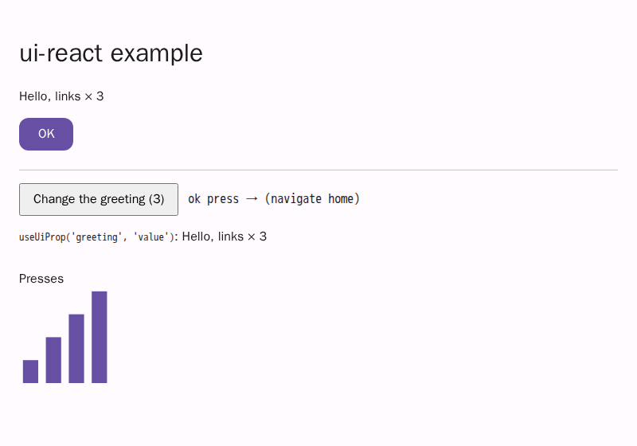

# @link-foundation/ui-react

The React adapter of the associative UI framework. `<UiView>` mounts the
[`@link-foundation/ui-dom`](../ui-dom/README.md) renderer into one
`<div data-ui-root>` and leaves the document to it: a change in the
[`ui-store`](../ui-store/README.md) store patches the DOM directly, and
`<UiView>` itself does not re-render. React components can read the store
through hooks built on `useSyncExternalStore`, handle the document's
`(on press ...)` actions, and draw custom kinds through portals.

Runtime dependencies: the workspace packages `ui-core`, `ui-store` and
`ui-dom`. `react` and `react-dom` (18 or later) are peer dependencies.

```jsx
import { UiView } from '@link-foundation/ui-react';

<UiView
  source={
    "(app: document (body: stack (ok: button (label 'OK') (on press (emit save)))))"
  }
  actions={{ save: () => console.log('saved') }}
/>;
```

renders

```html
<div data-ui-root="">
  <ui-document data-link-id="app">
    <ui-stack data-link-id="body">
      <ui-button data-link-id="ok"><button type="button">OK</button></ui-button>
    </ui-stack>
  </ui-document>
</div>
```

The example app [`examples/react/`](../../examples/react/) (Vite + React)
renders the issue-1 sample document, a counter that changes `greeting`
through the store, and a custom `chart` kind drawn by a React component:

```bash
npm --prefix examples/react install
npm --prefix examples/react run dev    # or: run build
```



## `<UiView>`

| Prop                                | Meaning                                                                            |
| ----------------------------------- | ---------------------------------------------------------------------------------- |
| `source`                            | Links Notation text; parsed once per distinct string.                              |
| `store`                             | A ui-store store; wins over `source` and the provider's store.                     |
| `parseOptions`                      | Options of ui-core `parse` for `source`.                                           |
| `actions`                           | Host functions by action name, or a registry with `has(name)` and `dispatch(...)`. |
| `onAction(detail, event)`           | Called for every action of this view, before its handler.                          |
| `onDiagnostic`, `onPatch`           | Parse and render diagnostics; the store events of each applied patch.              |
| `components`                        | React components of custom kinds: `{ chart: Chart }`.                              |
| `kinds`                             | Extra ui-dom kind renderers of this view only.                                     |
| `tokens`, `styles`, `theme`, `css`… | The ui-dom style options (ui-tokens and ui-style text).                            |
| `ssr`                               | Inline the static HTML of the document; the client replaces it on mount.           |
| `handleRef`                         | A ref that holds the ui-dom render handle (`nodeFor`, `flush`…) while mounted.     |
| `className`, `style`, `id`          | Set on the `<div data-ui-root>` container.                                         |

The store is resolved once per render: `store` prop, then `source`, then
the store of the enclosing `<UiProvider>`. Without one, `<UiView>` throws.
Render options are compared shallowly, so an inline `styles={text}` does
not remount the view; a new store, new options or new component kinds
destroy the old render and render again.

Kind renderers are passed to the ui-dom `render` of each view (the `kinds`
option), not registered globally with `defineKind`, so two views never
share or leak kinds.

## Actions

An action is data (docs/spec/behaviour.md): the document never runs code.
A click on `ok` in the example above dispatches a `ui-action` event with
the detail `{ source: 'ok', event: 'press', action: ['emit', 'save'] }`.
`<UiView>` calls `onAction(detail, event)`, then the first handler found by
name:

1. handlers registered with `useUiAction(name, handler)` inside the view or
   provider (the last registration wins);
2. the `actions` prop of the view;
3. the enclosing `<UiProvider actions>`, outwards.

For `(emit NAME ...)` the name `NAME` is tried first, then `emit`; for any
other action its head (`navigate`, `set`, `toggle`, `focus`). A plain
handler is called as `handler(detail, event)`; a registry gets
`dispatch(name, args, { detail, event })`, where `args` are the values after
the name. When handlers are configured but none matches, a development
warning is logged (`[ui-react] no handler for the action ...`) and the
action is ignored; production builds stay silent.

The vocabulary only knows the actions `navigate`, `emit`, `set`, `toggle`
and `focus`, so `(on press (save))` gets an `unknown-action` diagnostic and
is not bound. Write `(on press (emit save))` to call `actions.save`.

Each view handles only the events of its own nodes, so nested views do not
run each other's handlers.

## Hooks

```jsx
import {
  UiProvider,
  useUiAction,
  useUiProp,
} from '@link-foundation/ui-react/hooks';

function Greeting() {
  // Re-renders only when this property of `greeting` changes.
  const [text] = useUiProp('greeting', 'value') ?? [];
  return <p>{text}</p>;
}

function Saver() {
  useUiAction('save', (detail) => save(detail.source));
  return null;
}

<UiProvider store={store} actions={{ navigate: (d) => go(d.action[1]) }}>
  <Greeting />
  <Saver />
  <UiView />
</UiProvider>;
```

| Hook                                    | Returns, and re-renders when it changes                          |
| --------------------------------------- | ---------------------------------------------------------------- |
| `useUiStore(store, selector, isEqual?)` | `selector(store)`; equal results (default `Object.is`) are kept. |
| `useUiElement(id, store?)`              | The element view (`store.get(id)`), or `undefined`.              |
| `useUiProp(id, name, store?)`           | The values of one property, or `undefined`.                      |
| `useUiProps(id, store?)`                | Every property by name (`propsOf`).                              |
| `useUiAction(name, handler)`            | Registers a handler while mounted.                               |
| `useUiContext()`                        | `{ store, registry }` of the nearest provider or view.           |

Property values are arrays: `(gap 8)` is `['8']`. A positional value takes
the name the ui-core vocabulary gives it, so `(greeting: text 'Hello')`
has `value`. An explicit property of the same name wins, and so does the
last of repeated properties. The `store` argument defaults to the
provider's store; without either, the hook throws.

The hooks work in server rendering (the server snapshot is the same
getter) and in StrictMode.

### The DOM-free entry

`@link-foundation/ui-react/hooks` exports the provider, the hooks,
`createActionRegistry`, `propsOf` and `propOf`. It imports `react` and
the DOM-free `ui-core` (for the positional property names) only; no
module of `react-dom` or `ui-dom` is loaded, so it also runs in React
Native or a worker.

## Custom kinds as React components

```jsx
function Chart({ id, props, children }) {
  const series = (props.series ?? []).map(Number);
  return (
    <figure data-chart={id}>
      {series.join(', ')}
      {children}
    </figure>
  );
}

<UiView
  source="(sales: chart (title 'Sales') (series 3 5 8))"
  components={{ chart: Chart }}
/>;
```

A kind in `components` renders as `<ui-react-host data-kind="chart"
data-link-id="sales">`, and the component is mounted into it through a
portal, inside the React tree of `<UiView>` (context and error boundaries
apply). It receives `id`, `props` (updated when the store changes) and
`children`, the ui-dom nodes of the element's children. The host follows
inserts, renames and removes in the store. A custom kind is not in the
vocabulary, so its links (`(series 3 5 8)`) are kept in the element's
`unknown` links; `props` reads them as properties.

## Server rendering

`renderToString(<UiView source={text} />)` needs no `window` and returns
the empty container. With `ssr`, the container holds the static HTML of
ui-dom `renderToHTML`, which escapes all text and writes no `on*`
attributes:

```js
renderToString(<UiView source={text} ssr />);
// <div data-ui-root=""><ui-document data-link-id="app">…<ui-button data-link-id="ok">…
```

On the client (`hydrateRoot` or `createRoot`) the view clears the server
markup and renders live nodes. `renderViewToHTML(store, options)` returns
the same HTML without React; React-rendered kinds are empty hosts.

## Tests

```bash
node --test packages/ui-react/tests/*.test.js
```

The tests run React 19 in [jsdom](https://github.com/jsdom/jsdom) (MIT, a
dev dependency) with `act`, under Node.js, Bun (`bun test`) and Deno
(`deno test -A`). jsdom needs Node.js 22.22, 24.15 or 26; the package
itself runs on Node.js 20.

| File                   | Checks                                                                                                |
| ---------------------- | ----------------------------------------------------------------------------------------------------- |
| `document.test.js`     | `ui-button` with `data-link-id="ok"`; a store change patches the DOM with one render.                 |
| `hooks.test.js`        | `useUiProp` re-renders only for its property; the other hooks.                                        |
| `actions.test.js`      | `actions.save` once, `onAction` with the detail, unknown actions warn, nested views.                  |
| `components.test.js`   | A `chart` kind through a portal with updated props; insert, rename, remove, cleanup.                  |
| `strict-mode.test.js`  | One tree under `<StrictMode>`; no store or DOM listener left after unmount.                           |
| `ssr.test.js`          | `renderToString` without `window`; `ssr` output; hydration replaces the server markup.                |
| `no-dom-hooks.test.js` | The hooks entry's module graph has no `react-dom` or `ui-dom` module; it imports with no DOM globals. |

## License

[Unlicense](LICENSE) (public domain).
