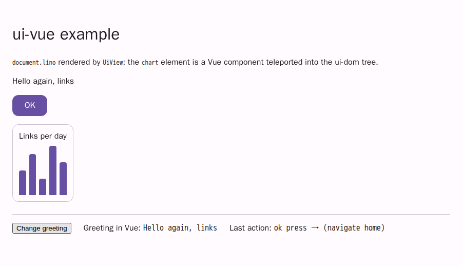

# @link-foundation/ui-vue

The Vue 3 adapter of the associative UI framework. It stays thin:
[`@link-foundation/ui-dom`](../ui-dom/README.md) renders the document as
plain custom elements, and this package mounts that renderer in a Vue
component, gives the [`ui-store`](../ui-store/README.md) store to Vue as
reactive refs, sends `(on …)` actions to Vue handlers and draws custom kinds
with Vue components.

- `UiView`: a component with the props `source`, `store`, `actions`,
  `components`, `ssr` and `options`, and an `action` emit.
- `createUiPlugin({ store, actions })`: provides a store and an action
  registry to the whole app (`provide`/`inject`, keys `UI_STORE_KEY` and
  `UI_ACTIONS_KEY`).
- Composables `useUiStore`, `useUiElement`, `useUiProp` and `useUiAction`:
  they return `Readonly<ShallowRef>` values and remove their store listener
  with `onScopeDispose`.
- `isUiCustomElement`: the `compilerOptions.isCustomElement` for `ui-*` tags.
- SSR: `renderToString` never touches `window`; the `ssr` prop inlines the
  ui-dom `renderToHTML` markup.

Vue (`^3.4`) is a peer dependency. The other runtime dependencies are the
workspace packages `ui-core`, `ui-store` and `ui-dom`.

## Quick start

```js
import { createApp, h } from 'vue';
import { UiView, createUiPlugin } from '@link-foundation/ui-vue';

createApp({
  render: () =>
    h(UiView, {
      source:
        "(app: document (ok: button (label 'OK') (on press (emit save))))",
    }),
})
  .use(createUiPlugin({ actions: { save: () => console.log('saved') } }))
  .mount('#app');
```

Clicking OK calls `save` once, with the ui-dom detail
`{ source: 'ok', event: 'press', action: ['emit', 'save'] }`.

Host actions are written `(emit save)`. The dialect only declares the
actions `navigate`, `emit`, `set`, `toggle` and `focus`
([behaviour.md](../../docs/spec/behaviour.md)), and renderers must ignore any
other head. So `(on press (save))` gives the ui-dom diagnostic
`unknown-action` and does nothing. In development, `UiView` also warns about
it unless you pass your own `options.onDiagnostic`.

The same view in a single-file component, with a store shared through the
plugin:

```vue
<script setup>
import { UiView, useUiProp } from '@link-foundation/ui-vue';
import SalesChart from './SalesChart.vue';

const props = defineProps({ store: Object });
const greeting = useUiProp('greeting', 'value'); // ['Hello, links']
const hello = () => props.store.setProp('greeting', 'value', ['Hello again']);
</script>

<template>
  <UiView :components="{ chart: SalesChart }" @action="console.log" />
  <button @click="hello">{{ greeting?.[0] }}</button>
</template>
```

### Vite: `ui-*` tags are custom elements

Vue templates compiled ahead of time must leave the ui-dom tags
(`ui-button`, `ui-stack`, `ui-vue-host`, …) to the browser:

```js
// vite.config.js
import { defineConfig } from 'vite';
import vue from '@vitejs/plugin-vue';
import { isUiCustomElement } from '@link-foundation/ui-vue';

export default defineConfig({
  plugins: [
    vue({
      template: { compilerOptions: { isCustomElement: isUiCustomElement } },
    }),
  ],
});
```

With the runtime template compiler, set
`app.config.compilerOptions.isCustomElement = isUiCustomElement` instead.

### Example app

[`examples/vue/`](../../examples/vue/) is a Vite + Vue app. It renders
[`document.lino`](../../docs/case-studies/issue-1/samples/document.lino)
with its styles and tokens, changes `greeting` through the store from a Vue
button, and draws a `chart` element with a Vue component (`SalesChart.vue`):

```bash
npm --prefix examples/vue install
npm --prefix examples/vue run build   # or: run dev
```



## `UiView`

| Prop         | Type                               | Meaning                                                                                  |
| ------------ | ---------------------------------- | ---------------------------------------------------------------------------------------- |
| `source`     | `string`                           | Links Notation text; a new store is created when it changes                              |
| `store`      | `Store`                            | a ui-store store; it wins over `source` and over the store of the plugin                 |
| `actions`    | `Record<string, handler>` or `Map` | action handlers by name, before the registry                                             |
| `components` | `Record<string, Component>`        | Vue components of custom kinds, by kind                                                  |
| `ssr`        | `boolean`                          | on the server, inline the static ui-dom markup                                           |
| `options`    | ui-dom `RenderOptions` and more    | `tokens`, `styles`, `theme`, `kinds`, `onDiagnostic`…, and `parseOptions`/`storeOptions` |

The store comes from the `store` prop, else from `source`, else from
`createUiPlugin`. Without any of them, the view stays empty and warns in
development. Other attributes (`class`, `style`, `id`…) go to the root
`<div data-ui-root>`.

The render function of `UiView` does not read store state, so it runs once
for any number of store changes. ui-dom patches only the nodes each
transaction changed. A new `store` or `source`, new `options` or a new set of
component kinds re-renders the document. The old store listeners are removed
first, as they are when the view unmounts.

### Actions

Each `ui-action` of the view (the F16 detail `{ source, event, action }`,
plus the DOM event) is handled in this order:

1. `emit('action', detail, event)`.
2. The handler names: `(emit NAME)` looks for `NAME` first, then `emit`;
   every other action looks for its head (`navigate`, `set`…).
3. For the first name that has handlers, the `actions` prop handler runs if
   there is one. Otherwise the handlers registered with `useUiAction` inside
   the view run, else those of `createUiPlugin`.
4. If no name has a handler, it is only a development warning, given once
   per name and view.

`actionNames(['emit', 'save'])` returns `['save', 'emit']`.

### Custom kinds with Vue components

```js
h(UiView, { store, components: { chart: SalesChart } });
```

For every element whose kind is in `components`, ui-dom creates a
`<ui-vue-host data-link-id="…" data-kind="chart">` in its place in the tree.
`UiView` renders the component into the host with `<Teleport>`, so the
component keeps the app context (plugins, `provide`/`inject`, devtools) and
the composables find the view's store. The only prop is `id`, the current
store ID of the element, which follows renames. The component reads the
element with the composables:

```js
const props = defineProps({ id: String });
const title = useUiProp(() => props.id, 'title'); // (title 'Q1') → ['Q1']
const values = useUiProp(() => props.id, 'values'); // (values 3 1 2)
```

Hosts are created and removed with their elements, and the component's store
listeners go with them. The kinds are per view (the ui-dom `kinds` option),
so they never touch the global `defineKind` registry or other views.

## Plugin

```js
const plugin = createUiPlugin({ store, actions: { save, navigate } });
app.use(plugin);
plugin.registry.register('save', handler); // returns off()
```

The plugin provides `UI_STORE_KEY` (only when `store` is given) and
`UI_ACTIONS_KEY` (the registry, always). Each `UiView` provides its own
store and a child registry, so the components inside it see the view's
store and register their handlers on the view, with the plugin's handlers
as the fallback.

## Composables

All of them take an optional last argument `store` (a store, a ref or a
getter). Without it they use the injected store and throw when there is
none. The value is a read-only shallow ref, computed when the composable is
called. It is updated once per committed transaction, and assigned only when
the value changed, so watchers and renders run only for real changes. The
store listener is removed when the effect scope (the component) is disposed.
On the server, a composable reads the value once and does not subscribe.

| Composable                     | Value                                                                                   | Changes when                        |
| ------------------------------ | --------------------------------------------------------------------------------------- | ----------------------------------- |
| `useUiStore(selector, store?)` | `selector(store)`                                                                       | the result differs (`Object.is`)    |
| `useUiElement(id, store?)`     | the frozen `ElementView` of `store.get(id)`, or `undefined`                             | a field of that element changes     |
| `useUiProp(id, name, store?)`  | the values of a property: named, else the positional value of the kind, else a sub-link | those values change (deep equality) |
| `useUiAction(name, handler)`   | `off()`, removing the handler from the nearest registry (also on scope dispose)         | —                                   |

`id` may be a string, a ref or a getter. `useUiProp('greeting', 'value')`
on `(greeting: text 'Hello, links')` is `['Hello, links']`: the positional
value under its vocabulary name. For a kind outside the vocabulary, such as
`(sales: chart (title 'Q1'))`, a sub-link `(title 'Q1')` gives `['Q1']`.
`propOf(view, name)` is the same lookup on an `ElementView`.

## Server rendering

```js
import { createSSRApp, h } from 'vue';
import { renderToString } from 'vue/server-renderer';

const html = await renderToString(
  createSSRApp({ render: () => h(UiView, { source, ssr: true }) })
);
// <div data-ui-root><ui-document data-link-id="app">…</ui-document></div>
```

`UiView` reads neither `window` nor `document` on the server. Without `ssr`
it renders an empty root. With `ssr` the root holds the static markup of
`renderToHTML`, with empty `<ui-vue-host>` elements for custom kinds. Custom
components only render on the client. When the app hydrates (`createSSRApp`
in the browser), the view clears its root and renders it with ui-dom, so the
events and the incremental patches work. `renderStaticHTML(store, options,
components)` and `storeFromSource(text, options)` are exported for direct
use.

## Tests

```bash
node --test packages/ui-vue/tests/
bun test packages/ui-vue/tests --timeout 30000
deno test -A packages/ui-vue
```

The tests run in jsdom with `@vue/test-utils`. Vue's DOM runtime reads the
global `document` when it is evaluated, and runtimes may evaluate its
CommonJS build before the ES module that installs jsdom
([experiments/cjs-order](../../experiments/cjs-order/main.mjs)). So
[`tests/setup-dom.js`](tests/setup-dom.js) installs the globals and then
loads `vue`, `@vue/test-utils` and this package with dynamic imports.

- `view.test.js`: renders `ui-button[data-link-id="ok"]`, store changes
  patch the DOM while the render function of `UiView` runs once, and 100
  mount/unmount cycles leave no store listeners and no `ui-*` nodes.
- `composables.test.js`: `useUiProp('greeting', 'text')` triggers a watcher
  only when that prop changes, and disposing the scope restores the listener
  count.
- `actions.test.js`: the `action` emit with the F16 detail, `actions.save`
  called once, warnings for unhandled and unknown actions.
- `components.test.js`: a `chart` kind rendered through `Teleport` follows
  store changes, inserts, removals and renames.
- `plugin.test.js`: the composables find the store of `createUiPlugin`.
- `ssr.test.js`: `renderToString` without `window`, `data-link-id="ok"` with
  `ssr`, and hydration.

## License

[Unlicense](LICENSE): public domain.
